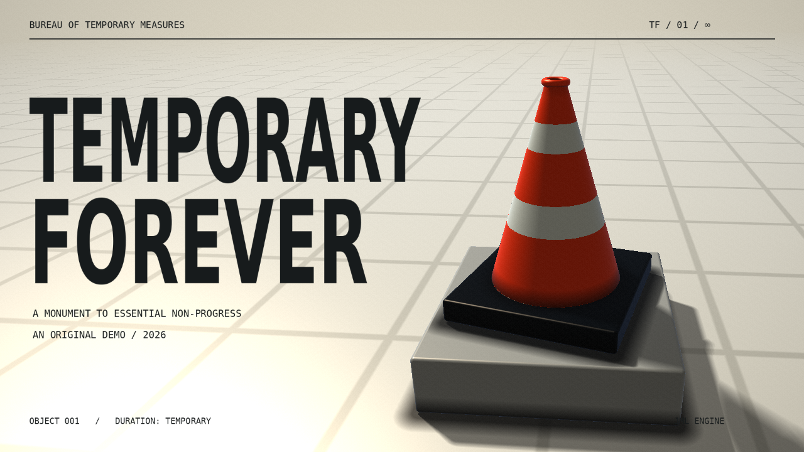

# TEMPORARY / FOREVER

An original **130.403-second audiovisual demo** in which a traffic cone becomes a monument, an institution, a city and a cosmic roadblock. Made for this task in conversation with Jumalauta's work, using its actual WebGL engine. This is an independent work, not a claim of official group authorship.



## Play and build

Requirements: **Node.js 22.12+** (or a newer supported Node LTS), npm, and a WebGL2/Web Audio browser. All runtime assets are local. No original-engine installation, tool server, account or CDN is needed.

From this project root:

```sh
npm ci
npm run dev
```

Open **http://localhost:5174/**. Click **ENTER THE WORK ZONE** once, or press Enter. It then plays through automatically. **F** toggles fullscreen; **Esc** exits. Clicking the running demo also exits, following the engine's convention. The menu returns after the ending. Headphones are recommended. Select Economy if rendering is slow; Full is sharpest on a suitable GPU. Keep the tab visible; the engine pauses inactive tabs.

Build and play the release:

```sh
npm run build
npm run preview -- --port 4173
```

Open **http://localhost:4173/**. Upload the complete contents of `dist/` to any static web server. Relative assets support hosting in a subdirectory. `file://` cannot load the shaders and music correctly; use HTTP.

The prebuilt release works without Node:

```sh
python3 -m http.server 8080 --directory dist
```

Open **http://localhost:8080/**. `temporary-forever-web.zip` contains this self-contained website. The source ZIP includes source, engine, assets, documentation and prebuilt `dist/`, without dependencies or external research productions.

## Engine and original implementation

Engine commit: **e58a1f6fc16e75003b2509a5471db27645191b41**, [jumalauta/jml-engine-webgl](https://github.com/jumalauta/jml-engine-webgl/tree/e58a1f6fc16e75003b2509a5471db27645191b41), vendored in `engine/`. Two local defaults disable tool mode and its development WebSocket connection; see [the exact patch](docs/engine-player-defaults.patch). Loader, animation, audio, timer and renderer implementations are unchanged.

- `public/data/Demo.js` — original scene score; JML animation definitions, named scenes, FBO composition, text animation and envelope bindings.
- `public/data/world.fs` — original procedural cone geometry, materials, architecture, orbital array and disassembly.
- `public/data/print.fs` — original diagram, printing pattern and interruption effects.
- `public/data/plates/` — original typography layouts, generated by `tools/plates.py` and animated as engine textures.
- `public/data/envelope.json` — independent sound measurements, not an audio stream.
- `src/` — launch menu and lifecycle presentation only.

JML's `Effect` loads resources and music; `Loader`/`Player` execute the scenes; its `Timer` drives uniforms and animation; its renderer draws every frame. There is no parallel renderer, prerecorded demo video, alternative music player or copied production scene.

## Music and exact duration

Exactly one track, played in full, unchanged, at rate 1, with looping disabled:

- **Track ID:** `rock-hybrid`
- **SHA-256:** `a56fe686900e20c75e3ec02c191338a9f4a69f11808677959e687f46b2e32054`
- **Catalogue duration:** 130.403278 seconds
- **Chromium/FFmpeg decoded duration:** 130.40326530612246 seconds
- **Demo duration:** the engine uses the decoded buffer's full length. The catalogue difference is approximately 13 microseconds of rounding.

Verify with `sha256sum public/data/music.mp3`.

The supplied attribution is reproduced unchanged in [music.txt](public/credits/music.txt):

> "Rock Hybrid" by Kevin MacLeod (incompetech.com)  
> Licensed under Creative Commons Attribution 4.0 International  
> https://creativecommons.org/licenses/by/4.0/  
> Source: https://incompetech.com/music/royalty-free/index.html?Search=Search&isrc=USUAN1100094  
> Original audio: https://incompetech.com/music/royalty-free/mp3-royaltyfree/rock%20hybrid.mp3  
> ISRC: USUAN1100094  
> Music unchanged.

[Timing notes](docs/TIMING.md) explain the STFT/onset refinement, estimated 116 BPM phase and authored score. Estimates are not represented as a listening-verified beat grid. `music-catalog.json` and `research-sources.json` preserve the supplied metadata.

## Credits and reuse rights

Original concept, code, procedural geometry, layouts and choreography: **Codex**, created for this task. Original material is provided under [MIT](LICENSE). Supporting materials retain their licenses:

| Material | Credit and source | Rights / packaged notice |
| --- | --- | --- |
| JML engine and embedded resources | Mika Rautio and contributors; [pinned source](https://github.com/jumalauta/jml-engine-webgl/tree/e58a1f6fc16e75003b2509a5471db27645191b41) | zlib; `engine/LICENSE`, `public/credits/jml-engine.txt` |
| Glyphs in the original plates | [DejaVu Fonts](https://dejavu-fonts.github.io/), Sans Bold and Sans Mono | Bitstream Vera/DejaVu license; `public/credits/dejavu.txt` |
| Three.js and add-ons | Three.js authors | MIT; `public/credits/dependencies.txt` |
| @tonejs/midi, midi-file, array-flatten | Respective library authors, via engine dependencies | MIT; notices in `public/credits/` |
| stats.js | mrdoob and contributors | MIT; `public/credits/dependencies.txt` |
| Tweakpane | cocopon | MIT; `public/credits/tweakpane.txt` |
| jsRocket | Rocket contributors, bundled by engine | MIT; `public/credits/jsrocket.txt` |
| Rock Hybrid | Kevin MacLeod | CC BY 4.0; attribution above |

The menu uses system fonts; no fonts are fetched at runtime. No shared Jumalauta fist/logo, production asset, utility, shader or sync file was reused. Research checkouts are excluded from the release.

## Research and testing

[Research notes](docs/RESEARCH.md) link pinned sources and output references for **Hauho**, **Auto 2000**, **Feles Contra Omnia**, source-only study of **Summis Vita In Armento**, and the authorship check distinguishing **Ajna** from Jumalauta. They explain what was learned and how this work differs.

**I could not actually hear audio in this environment.** I inspected waveform/spectral data and enabled and measured real browser audio playback. Those measurements are not a listening review.

[Testing notes](docs/TESTING.md) record actual browser results and limits. To rerun the complete uninterrupted test, leave the production preview running on port 4173, then in a second terminal:

```sh
npx playwright install --with-deps chromium
npm run test:browser
```

The test takes the full duration. It launches Chromium without its mute-audio flag, clicks Start, checks the running AudioContext and nonzero analyser output, measures engine/audio clock agreement and frame delivery, captures timed frames and verifies natural completion. It does not seek, speed up, trim or loop. Results are in `tests/playback-report.json`.

Optional asset regeneration needs Python 3, FFmpeg, NumPy, SciPy, Pillow, Matplotlib and DejaVu fonts at the paths in the scripts. These are **not** build/playback dependencies; generated assets are included:

```sh
python3 tools/plates.py
python3 tools/analyze.py
npm run build
```
